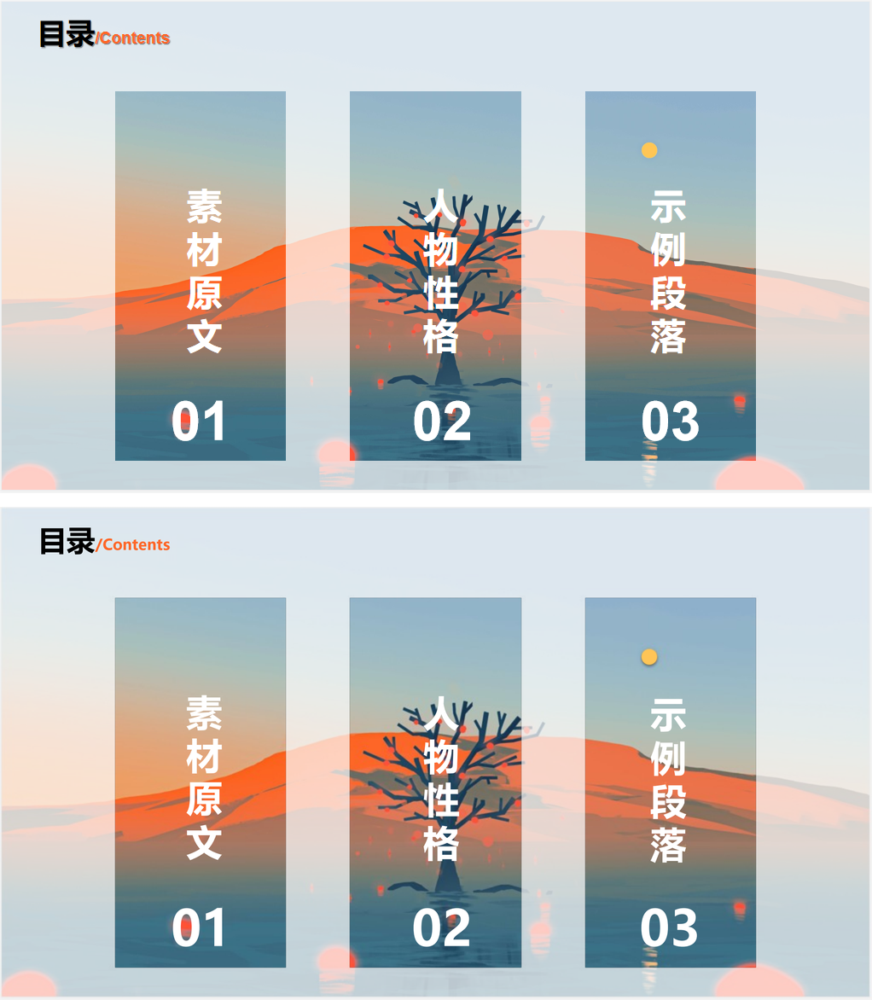

# ppt-rebuild · 把幻灯片截图重建成可编辑 PPTX

一个给 AI 代理用的技能（DSH skill）：给它一张幻灯片截图，它按固定工序测画布、拆图层、
重建原生形状与文本、渲染比对，产出「每个部分都能改」的 PPTX。

本仓库同时提供**完整提示词**，所以不用 DSH 的模型也能照着做。



## 里面有什么

```
ppt-rebuild/          技能本体（放进 ~/.dsh/skills/ 即生效）
  SKILL.md            触发条件、铁律、30 秒开工、坑对照表
  README.md           安装 / 依赖 / 移植性
  references/PROMPT.md        完整提示词（给其他模型）
  references/blocks-example.json
  scripts/doctor.py   环境预检（依赖 / 渲染器 / 字体）
  scripts/render.py   pptx→PDF→PNG（绕开 1.5× 缩放 bug）
  scripts/inkcmp.py   逐块墨迹偏差 + MAE + diff
  scripts/maskfit.py  蒙版 alpha 与洞的边界（像素阶跃）
  scripts/inpaint.py  擦照片上的字
  scripts/rounded.py  异形圆角裁图
examples/             一张真实案例：原图、重建图、并排对比
```

## 安装

把 `ppt-rebuild/` 整个文件夹放到：

```
~/.dsh/skills/ppt-rebuild/        # Windows: %USERPROFILE%\.dsh\skills\ppt-rebuild
```

新开一个 DSH 会话，技能列表里会出现 `ppt-rebuild`。

自检：

```powershell
python "%USERPROFILE%\.dsh\skills\ppt-rebuild\scripts\doctor.py"   # 期望 "ok": true
```

## 依赖

- Python 3.9+、Pillow、numpy（DSH 自带运行时即可）
- 渲染：DSH 自带 LibreOffice Kit（自动发现），或系统 LibreOffice + PyMuPDF
- 字体：微软雅黑（必需）、华文行楷 / Bodoni MT（标题类，缺了要重标字号）

## 不用 DSH？

把 `ppt-rebuild/references/PROMPT.md` 整份发给任意能跑代码的模型，附上截图即可；
脚本是加分项。

## 它解决的问题（也是踩过的坑）

1. 把截图整张当背景 → 什么都不“可编辑”；
2. 照片里留着头标题 → 文本盖上去变两层字；
3. 阴影被压缩吃掉 → 按“边缘是白的”误判为无阴影；
4. 卡片当成叠图 → 底部出现鲜色带（实际是蒙版开洞，洞底边比卡片视觉底边高 30 px）；
5. 直接渲染 pptx 放大 1.5 倍 → 必须 convert→PDF→render。

## 许可

MIT，见 [LICENSE](LICENSE)。
